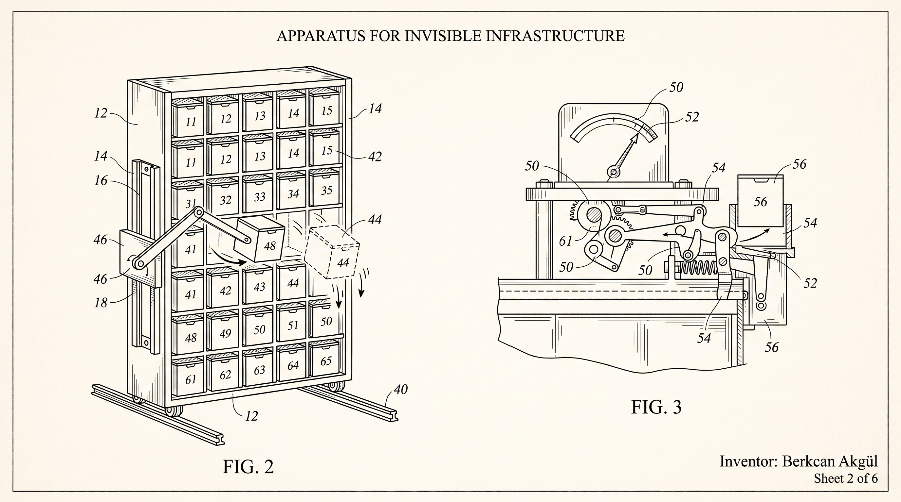
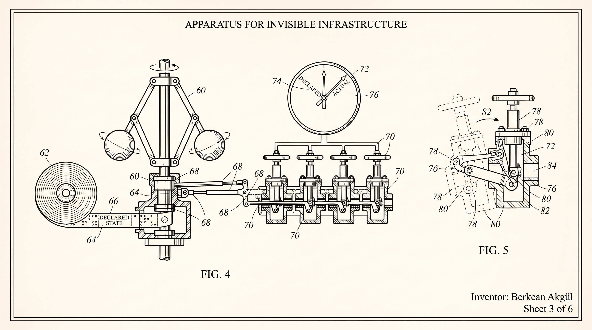
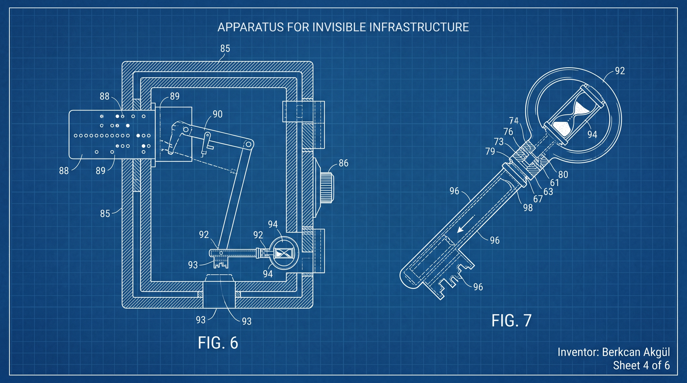
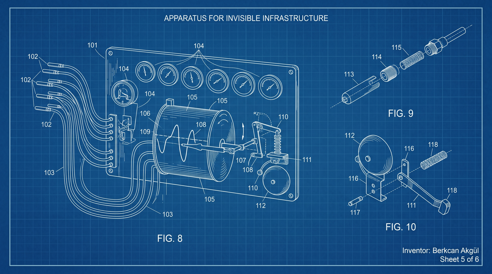
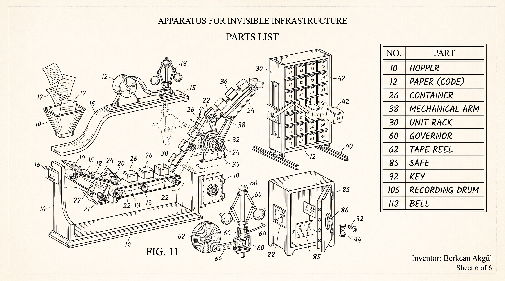

<!--
  github.com/MBA76 — profile README.
  Structure: a patent filing. Sheet 1 is the general arrangement, then one drawing sheet at the
  head of each section, ending with the parts list.

  Assets are repo-relative: they resolve on both the profile and the repo page.
  No badge or stat services, nothing that can rate-limit or go stale.
  Every sheet's meaning is repeated as real text beneath it — burned-in type is unreadable on a phone.
  Image prompts for every sheet live in IMAGE_PROMPTS.md.
-->

  <picture>
    <source media="(prefers-color-scheme: dark)" srcset="assets/sheet-1-dark.jpg">
    <source media="(prefers-color-scheme: light)" srcset="assets/sheet-1-light.jpg">
    
  </picture>

  <i>Sheet 1 — General Arrangement.</i> 
  <b>Berkcan Akgül</b> &nbsp;·&nbsp; DevOps &amp; Cloud-Native Engineer &nbsp;·&nbsp; Istanbul 
  Kubernetes, GitOps and the pipelines that ship code to production without anyone holding their breath.

  <a href="https://linkedin.com/in/berkcanakgul">LinkedIn</a>
  &#8287;·&#8287;
  <a href="https://medium.com/@mberkcan1532">Medium</a>
  &#8287;·&#8287;
  <a href="https://berkcan.akgul.tr">berkcan.akgul.tr</a>

  <b>Sheets</b>&#8287;&#8287;
  <a href="#orchestration">2. Self-Healing Engine</a>
  &#8287;·&#8287;
  <a href="#gitops-and-delivery">3. Declarative Governor</a>
  &#8287;·&#8287;
  <a href="#secrets-and-security">4. Ephemeral Key Safe</a>
  &#8287;·&#8287;
  <a href="#observability">5. Signal Apparatus</a>
  &#8287;·&#8287;
  <a href="#parts-list">6. Parts List</a>

## Abstract

An apparatus for moving code from a `git push` to a running workload without human hands on the
lever. Clusters are run on Kubernetes and packaged with Helm; GitLab CI/CD builds, tests and scans
every change; ArgoCD holds each environment to the state declared in Git. Secrets are issued by
Vault, briefly, and never written down. Everything that runs is measured, and everything measured
has an alert someone actually reads. The intended result is infrastructure nobody notices —
because it never gives them a reason to.

> 🇹🇷 Akıllı, güvenli ve ölçeklenebilir sistemler kuruyorum. Kubernetes, GitOps ve CI/CD
> otomasyonu üzerine çalışıyorum; koddan altyapıya uçtan uca mühendisliğe inanıyorum.

## Orchestration

  

  <i><b>Sheet 2 — Self-Healing Engine.</b> Fig. 2 shows a unit failing and its replacement already on the way. 
  Nobody is paged; the machine keeps the count it was told to keep.</i>

- **Kubernetes** clusters designed, upgraded and kept boring — workloads, networking, ingress, autoscaling
- **Helm** charts written to be reused, not copy-pasted between environments
- **Docker** images that are small, reproducible and scanned before they ever leave CI

## GitOps and delivery

  

  <i><b>Sheet 3 — Declarative Governor.</b> The tape is Git; the governor is ArgoCD. 
  What is declared is what runs — drift is pulled back automatically, not argued about.</i>

- **ArgoCD** as the single source of truth for what is deployed, where, and at which version
- **GitLab CI/CD** pipelines: build, test, scan, package, promote — every step visible, every step repeatable
- **Terraform** for the cloud underneath, reviewed like any other code

## Secrets and security

  

  <i><b>Sheet 4 — Ephemeral Key Safe.</b> A key is issued to whoever is allowed, for as long as needed. 
  Then it stops working. Nothing worth stealing is ever written down.</i>

- **HashiCorp Vault** for dynamic secrets and short-lived credentials
- **DevSecOps** baked into the pipeline: image scanning, policy checks, least-privilege RBAC

## Observability

  

  <i><b>Sheet 5 — Signal Apparatus.</b> Probes, a recorder, and a bell that rings only when it should. 
  You cannot fix what you cannot see — and you should not be woken for what does not matter.</i>

- **Prometheus** and **Grafana** for metrics and dashboards that answer real questions
- Alerting tuned to wake people up only when it matters
- **PostgreSQL** operations — backups, replication, and the slow query nobody wanted to look at

## Parts List

  

  <i><b>Sheet 6 — Parts List.</b> What the apparatus is actually built from.</i>

**Orchestration** &nbsp;`Kubernetes` `Helm` `Docker` `containerd`

**Delivery** &nbsp;`ArgoCD` `GitLab CI/CD` `Terraform`

**Security** &nbsp;`HashiCorp Vault` `RBAC` `Image scanning`

**Observability** &nbsp;`Prometheus` `Grafana` `Alertmanager`

**Ground** &nbsp;`Linux` `Bash` `PostgreSQL` `Cloud`

## Notes

I write about what I learn on [Medium](https://medium.com/@mberkcan1532) — Kubernetes, GitOps and
the occasional war story from production. The longer version of everything here is on
[berkcan.akgul.tr](https://berkcan.akgul.tr), and the best place to reach me is
[LinkedIn](https://linkedin.com/in/berkcanakgul).

  <i>“Invisible infrastructure, visible impact.”</i>

<!-- 
## Colophon

Six drawing sheets, made for this profile and stored in this repo, in the manner of an early
twentieth-century patent filing: fine ink line, reference numerals, figure numbers. Sheet 1 comes
in two versions — ink on paper for light theme, white line on blueprint blue for dark — swapped by
`<picture>`. Every sheet's caption is repeated as real text underneath it, because burned-in type
disappears on a phone.

No badge services, no counters, nothing that can rate-limit or go stale.
 -->